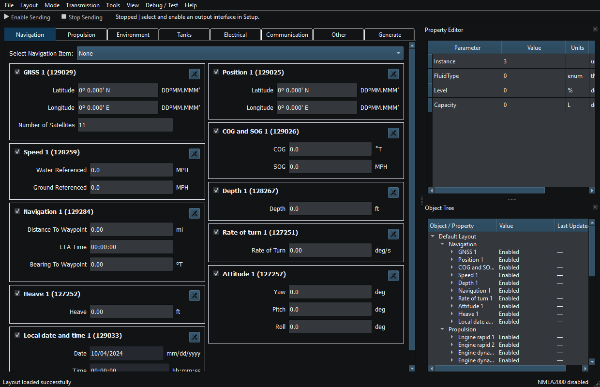
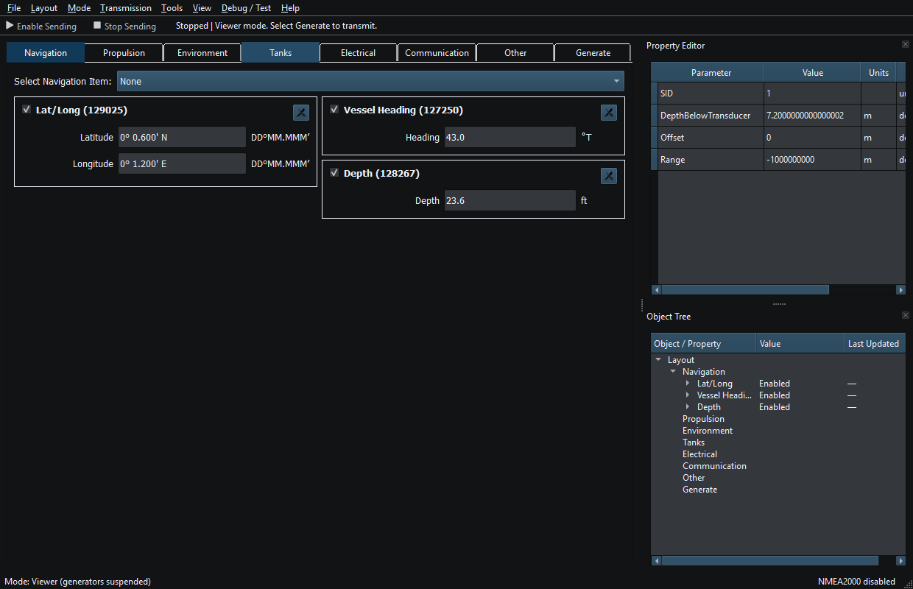
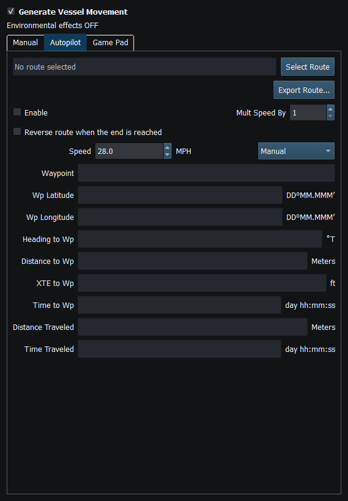

# RayNmeaSimulator

**Inspect marine data. Build a virtual vessel.**

RayNmeaSimulator is a desktop application for receiving, displaying and generating
supported **NMEA2000 and NMEA0183** data. Use it to explore instrument values,
create repeatable vessel simulations, follow routes and test how compatible
marine software and equipment respond.

**v0.1.0 preview:** public downloads and the online manual are not published yet.
The complete User Guide is included in the application and works offline.

## Two ways to work

- **Viewer RX** receives supported messages and creates or updates instruments.
  Inspect source identities, values and units in the instruments, Property Editor,
  Object Tree and Diagnostics. Receiving does not authorize instrument Sending.
- **Generate** builds a virtual vessel from instruments and optional generators.
  Set values manually or bind compatible dynamic sources, then deliberately
  authorize output when your test connection is ready.

NMEA2000 coverage includes navigation, propulsion, transmission, environment,
tanks, electrical measurements and selected communication/control data.
NMEA0183 has its own serial path and sentence instruments. The manual lists
[48 supported PGNs](https://rfstateside.github.io/RayNmeaSimulator/nmea2000-pgns.html) and
[18 sentence formatters](https://rfstateside.github.io/RayNmeaSimulator/nmea0183-sentences.html), with direction
and field limitations; these are specific implementations, not universal protocol support.

## Explore a virtual vessel

- **Movement and Autopilot:** steer manually, use a compatible SDL-mapped game
  controller, or follow a selected route with the VesselMovement Autopilot.
- **Routes and chartplotters:** import/export GPX or KML, inspect route snapshots,
  and retrieve supported Axiom routes through compatible configured connections.
  Route selection, route requests, motion and external Sending are separate actions.
- **Marine software:** feed compatible receivers such as OpenCPN using a suitable
  transport. The owner has observed simulated route-following vessel movement in
  OpenCPN; this is interoperability in that setup, not a promise about every receiver.
- **Instruments and generators:** combine navigation, engine, transmission,
  environmental, AIS and other supported instruments. Generators provide optional
  dynamic values; manual-value transmission does not require one.
- **Reusable workspaces:** save Layouts, manage your own editable Templates, and
  choose a theme, including the Darkeum theme shown here.
- **Diagnostics and logs:** inspect supported device identities and messages,
  view application logs, and optionally record NMEA traffic separately.

### Start with a bundled Template or Default Layout

Six read-only Templates ship with the application: **Default**, **Environment /
Weather**, **Navigation / Autopilot**, **Single Engine**, **Synthetic AIS
Demonstration** and **Twin Engine**. Duplicate a bundled Template to customize
an independent user Template.

**Layout → Load Default Layout** opens the supplied eight-group, 35-widget
workspace. Your saved Layouts and user Templates remain separate. Loading either
a Template or Default Layout never grants permission to send externally.

## Connections and platforms

| Connection | Use and important limits |
| --- | --- |
| Network NMEA2000 / RayNetworkBridge | Supported PGN receive/send and compatible authenticated route services. |
| Native SocketCAN | Linux CAN interfaces; configure the interface and physical network separately. |
| CANable SLCAN / Waveshare USB-CAN-A | Supported serial CAN adapters on Windows/Linux, with compatible firmware and wiring. |
| Actisense NGT-1 | Receive supported; Release transmission is disabled. Debug transmission is experimental. |
| NMEA0183 serial | Receive/send supported sentences using the correct port, baud rate and electrical interface. |
| Signal K | Publish supported mapped measurements; raw CAN transport and Viewer subscription are not implemented. |

Windows x64, Ubuntu x86_64 and native Linux ARM64/Raspberry Pi development and
private package workflows have been exercised. **Debian 12 ARM64 requires its
specific compatibility package**; a package built on newer Linux is not
interchangeable. macOS build support is present, with native acceptance still
pending. Choose a package for your actual OS, processor and runtime requirements.
See [platform details and limits](docs/capabilities-and-support.md).

## Installation

Use a package supplied for your platform; public downloads are not available yet.
Application packages include the required Qt runtime, so a Qt development SDK is
not needed to run them. Recorded system prerequisites still apply.

- **Windows x64:** close the application, run the supplied installer and follow its
  prompts. Keep the application's installed runtime files together.
- **Linux:** verify the supplied SHA-256 sidecar, extract the matching archive,
  enter its `RayNmeaSimulator` directory and run `./install.sh`. The per-user
  installer defaults to `~/.local/opt/RayNmeaSimulator`; it does not upgrade your
  OS or replace system Qt/glibc. Keep user data outside the program prefix.
- **Debian 12 ARM64:** use the archive explicitly marked **Debian12**, following
  the [Debian 12 instructions](deployment/linux/README-Debian12-ARM64.md).

Updates and uninstall preserve application data outside the managed program
prefix. Back up important Layouts and Templates before making your own changes.
See [Windows](deployment/windows/README.md) and
[Linux installation/package details](deployment/linux/README.md).

## Quick Start

1. Start the application and keep **Sending stopped**. F12 invokes emergency Stop.
2. Choose **Mode → Generate (Tx)**. Load the Default Layout or create a Layout
   from one of the six bundled Templates.
3. Select an instrument and inspect its values, units and identity in Property
   Editor and Object Tree. Change a manual value and commit it with Enter.
4. Add or enable a compatible generator only when dynamic values are useful.
   For movement, deliberately select Manual, Game Pad or Autopilot and its inputs.
5. Save your workspace as a new Layout. You can explore locally without authorizing output.
6. For an external test, configure the intended interface in Setup, confirm its
   status, review each instrument's Enable/interval, then explicitly choose
   **Enable Sending**. Inspect an independent receiver and stop deliberately.

For reception, choose **Viewer RX**, configure a supported input and inspect
incoming data. Viewer is not a guarantee of electrical silence: CAN signaling
and protocol management may still occur. Use an appropriate isolated test network.

## Help

Open **Help → RayNmeaSimulator Help**, or press **F1**, for the complete
**51-topic offline User Guide**. Search covers article text and captions;
contextual F1 opens related guidance. Select screenshots to enlarge them.

The matching online edition is prepared for
[rfstateside.github.io/RayNmeaSimulator](https://rfstateside.github.io/RayNmeaSimulator/).
**That site has not been published yet.** Both editions use the same manual
sources. [Local preview instructions](docs/online-help/README.md) are available
for reviewing the website before publication.

## Known limitations

- This is a **Public Engineering Reference — AS-IS**, not a certified navigation
  system, collision-avoidance tool or substitute for vessel instrumentation.
- Supported PGNs, sentences, fields and directions are bounded by the message
  references. A Diagnostics entry or successful connection does not establish
  complete receive/transmit support or delivery on the wire.
- Release Actisense output is disabled; arbitrary adapter-to-adapter Bridge Mode
  and Signal K Viewer subscription are not available.
- Additional automatic APB/RMB navigation mappings remain limited. Selecting a
  route alone does not start movement, issue a route request or authorize Sending.
- Controller mappings, receiver behavior and physical transports depend on the
  actual device/setup. Do not treat one working demonstration as universal compatibility.

Read [Known Limitations](https://rfstateside.github.io/RayNmeaSimulator/known-limitations.html) and the
[connection guidance](https://rfstateside.github.io/RayNmeaSimulator/connection-troubleshooting.html) for details.

## Build from source

The supported build is **C++17, Qt 6, CMake/CTest and Ninja**, with verified pinned
marine dependencies and SDL2. Start with the [fresh-clone CMake guide](docs/build-cmake.md),
then [Windows](docs/build-windows.md), [Ubuntu](docs/build-linux.md) or
[Raspberry Pi ARM64](docs/build-raspberry-pi.md). Dependency acquisition is explicit;
normal configure/build verifies an existing stage. See [tests](tests/README.md)
and the [Deploy workflow](deployment/README.md) for development and packaging.

## License, credits and Support

Copyright © 2024–2026 **RF StateSide LLC**. Original RayNmeaSimulator software is
licensed under **GNU AGPL-3.0-or-later**; see [LICENSE](LICENSE).
The AS-IS designation does not replace that license or its terms.

Thanks to the NMEA2000/NMEA0183 contributors, including Timo Lappalainen,
Al Thomason and other credited authors; Qt, SDL2 and other components retain
their own licenses. Qt Charts has GPLv3/commercial terms. See
[third-party notices](THIRD_PARTY_NOTICES.md), [provenance](PROVENANCE.md) and
**Help → About → Licenses and Acknowledgments** for credits and applicable terms.

[Voluntary Support through PayPal](https://www.paypal.com/ncp/payment/4SEDB7WY59T84)
helps development, testing and documentation. Contributions do not unlock
features, technical support, warranties or services. Payments are handled by PayPal.

Visit [RF StateSide](https://www.rfstateside.com/) or report a reproducible problem
in the repository with your version and a small, sanitized example. Keep credentials,
private routes and vessel information out of reports; see [SECURITY.md](SECURITY.md).
